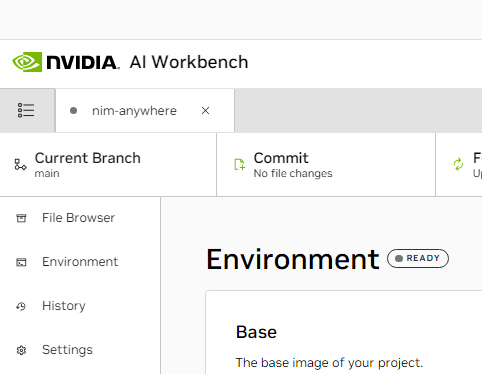

## Configure this project
The project must be configured with an application secret and your NGC personal key.

<b>Expand this section for a details on configuring this project.</b>

1. Before running for the first time, the project secrets must be configured in Workbench. This is done using the *Environment* tab from the left-hand panel.

    

1. Scroll down to the **Secrets** section and find the *NGC_API_KEY* entry. Press *Configure* and provide the personal key for NGC that was generated earlier.

1. Configure *NIM_ANYWHERE_API_KEY* with a random secret of at least 32 characters. For example, generate one with `openssl rand -hex 32`. This key protects the frontend, chain server, tutorial, sessions, and Redis. Do not commit it to the repository.

    The frontend uses HTTP Basic authentication with `nim-anywhere` as the username and this secret as the password. The tutorial asks for the secret directly.

